[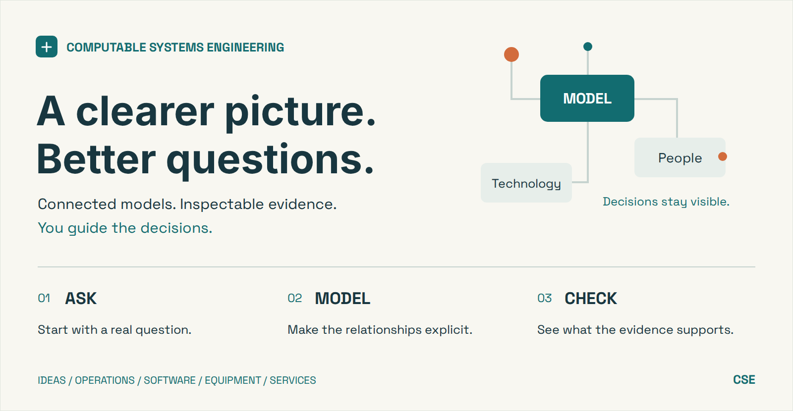](assets/readme/cse-overview.svg)

# Computable Systems Engineering

**Go from a question to connected models, clear diagrams, and evidence you can inspect.**

CSE is a set of skills for Codex that helps you design and investigate systems: a software service, a piece of equipment, a laboratory workflow, or the people and tools behind an operation. Describe what you want to understand in plain language. The assistant organizes the model, creates useful views, and runs supported checks. You guide the decisions.

Systems engineering asks how the pieces fit together, what should happen, and how you will know. CSE gives those questions a shared, editable model, so the conversation can develop into work you can inspect and revise.

[Try it](#try-it-with-codex) · [See a connected system](#see-the-system-you-actually-selected) · [Explore examples](#examples-you-can-open-and-inspect) · [Setup](#get-started) · [Capabilities and limits](#what-a-result-tells-you)

**Alpha · Local execution · Open source.** Models use SysML v2, a systems modeling language; you can start without knowing its syntax. Native checks require Linux, Python 3.10+ and Java 21+.

## Start with the question that matters to you

| You want to understand… | Ask CSE to… | Inspect… |
| --- | --- | --- |
| What a system needs to do | Develop a concept, break down functions, and compare alternatives | Needs, functions, assumptions, and open decisions |
| How work happens | Walk through normal operation, exceptions, and recovery | People, responsibilities, exchanges, and handoffs |
| What is in the current design | Reconcile the selected system, nested parts, external peers, and connections | Exact model identities, current selections, and omitted facts |
| Whether a claim holds | Run a supported check against retained scope and supplied evidence | A result, the inputs behind it, and the check's limits |

For systems engineers, software and hardware teams, service designers, operations teams, researchers, and students working through a complex problem. A focused question is enough; a complete specification is optional.

## Try it with Codex

Open this repository in Codex and start with one of these requests. The assistant handles the files and commands.

**Explore an idea**

```text
Use the system-concept skill to help me explore a shared equipment service.
Identify the people, functions, and alternatives. Keep assumptions and unknowns
visible, and leave consequential choices open for me to review.
```

**Walk through a difficult day**

```text
Use the operational-scenarios skill with the water-sampling station example.
Show the normal handoff and the missing-label recovery. Explain who does what,
what information moves, and what still needs evidence.
```

**Inspect a connected design**

```text
Use the system-concept skill with examples/configuration-review/connected.
Use its retained scope and both SysML files to check the selected current system,
its sensor, and its external receiver. Generate the current-system view, then
check that the saved view still agrees with a fresh native reconciliation.
```

For your own project, point CSE at your existing material and the question you want to answer. Keep private sources and project-specific models in your project's private work directory, outside the installed plugin and out of Git.

## See the system you actually selected

A library may contain the right kinds of parts while the current design connects the wrong instance. CSE's new configuration review checks the selected native identities and their context across the supplied model files.

You keep a separate record of what the design is expected to include: the retained scope. Checking against this record makes a missing selected role or retargeted connection visible.

[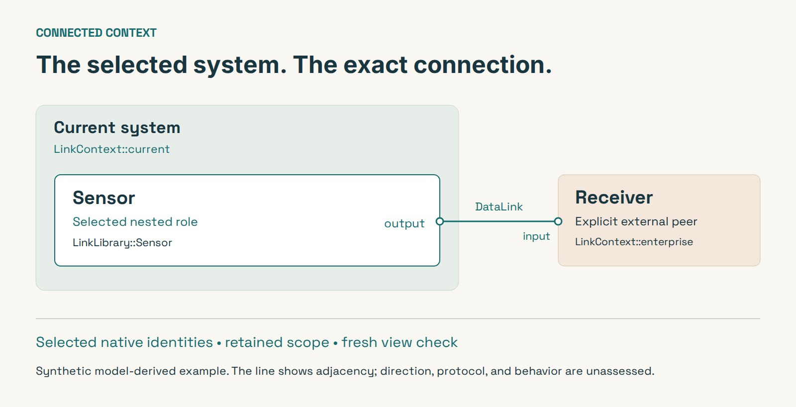](assets/readme/connected-overview.svg)

This view comes from the [two-file synthetic model](examples/configuration-review/connected/README.md) and its separately retained [selection scope](examples/configuration-review/connected/scope.json). The model also contains an unselected historical system and a second receiver. Their matching types cannot stand in for the selected endpoints. The line represents native adjacency; it does not establish data-flow direction or protocol compatibility.

[Editable illustration](assets/readme/connected-overview.svg) · [Native-generated SVG](examples/configuration-review/connected/generated/system.svg) · [HTML reader](examples/configuration-review/connected/generated/index.html) · [Trace ledger](examples/configuration-review/connected/generated/view.json)

The illustration shortens labels for reading. The native-generated view and ledger retain full identities, diagnostics, findings, and omissions. See the [reconciliation contract](docs/configuration-review.md) for the checked semantics.

**A picture can go stale.** CSE can rerun the native review and compare a saved view with freshly derived artifacts. Changed sources, retargeted connections, altered SVGs, and stale success labels cannot silently preserve a passing view check. The [system-view guide](docs/configuration-system-view.md) explains what is compared. Download the HTML reader and its sibling files to open it locally.

## Keep the work connected as it grows

- **Use several model files together.** Shared definitions and current-context declarations can remain separate while the checker evaluates the explicit file set.
- **Keep nested roles visible.** Documentary review can include roles declared inside part definitions, with their native identities and selected parent chains.
- **Separate today's design from alternatives.** Retained scope identifies the selected root and roles. Historical declarations and open alternatives do not become current selections just because they exist.
- **Keep drafts and scratch files in the project.** User-specific models and reports belong in private workspace storage, outside an installed plugin. Computed verdicts come from the checker; consequential engineering decisions stay with you.

## Examples you can open and inspect

The examples use fictional sample-handoff and community tool-library services. Their limits, allocations, and observations are demonstration choices. Each preview has source links and an editable counterpart.

### Understand the work

[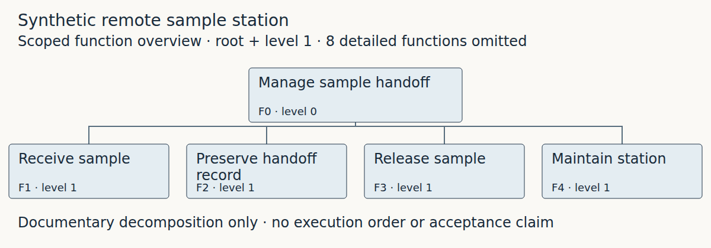](examples/engineering-gallery/water-sampling/generated/function-tree/index.html)

Start with the [function breakdown](examples/engineering-gallery/water-sampling/README.md), follow an [operational exchange](examples/readme-showcase/README.md#normal-handoffs), or compare [tool-library alternatives](examples/readme-showcase/README.md#tool-library). Functions describe work; the tree's branches describe decomposition.

### See the effect of a concrete check

The sample station includes synthetic evidence that meets a receipt deadline, arrives late, or remains incomplete. A separate finite model demonstrates a blocked handoff. These examples expose the condition behind each result.

<details>
<summary>Explore eight source-linked examples</summary>

#### Normal handoffs

[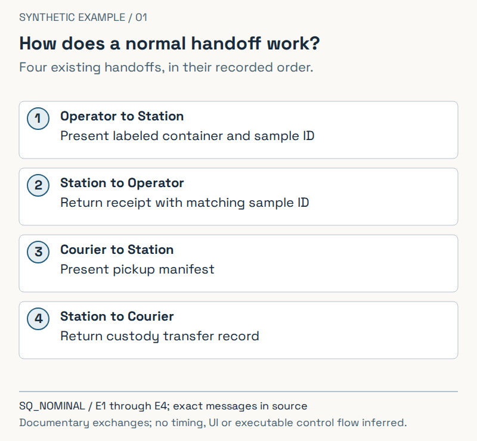](examples/readme-showcase/README.md#normal-handoffs)

#### Missing-label recovery

[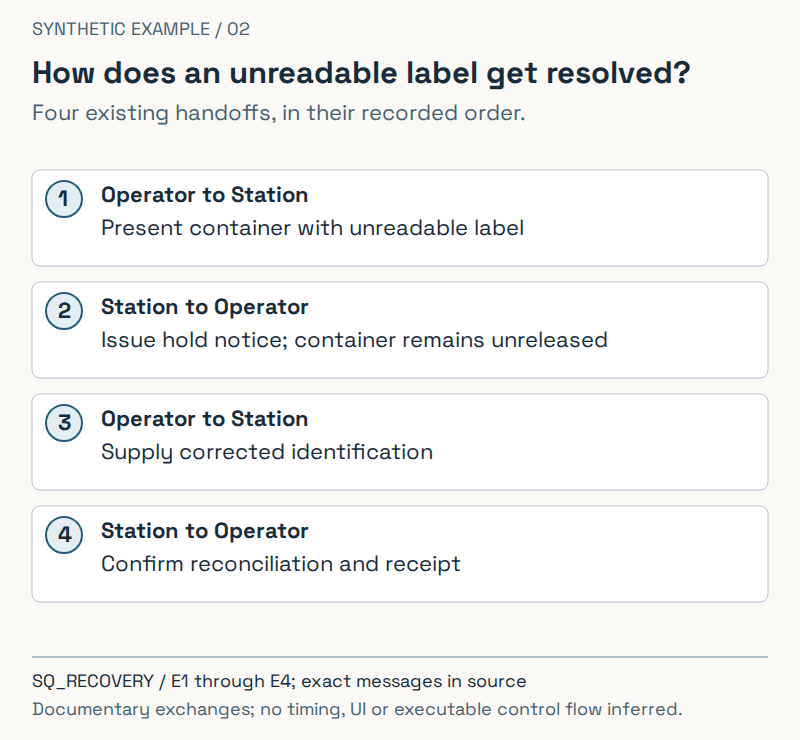](examples/readme-showcase/README.md#label-recovery)

#### Responsibilities

[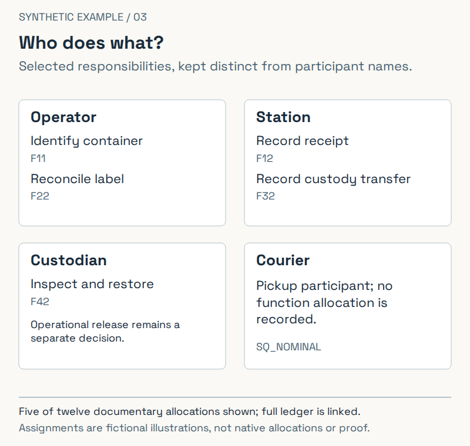](examples/readme-showcase/README.md#responsibilities)

#### Needs and requirements

[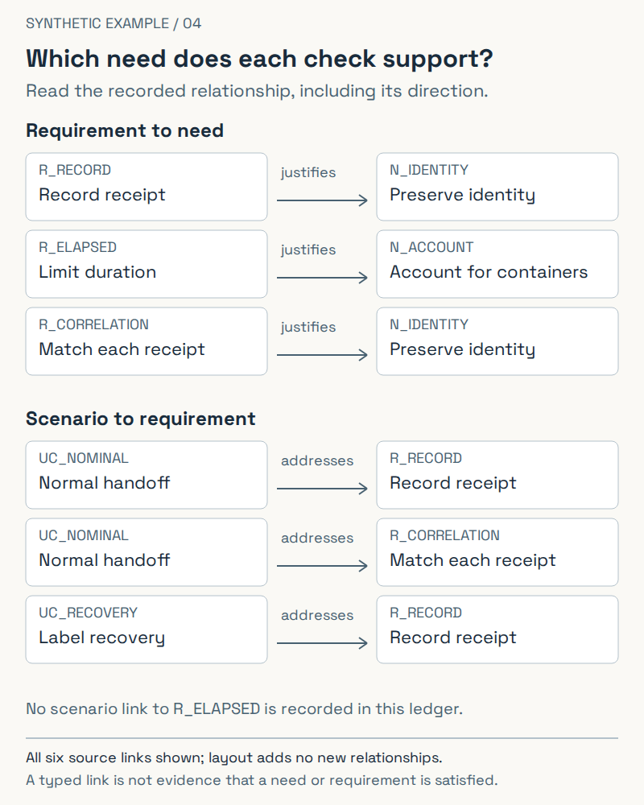](examples/readme-showcase/README.md#need-traces)

#### Receipt deadlines

[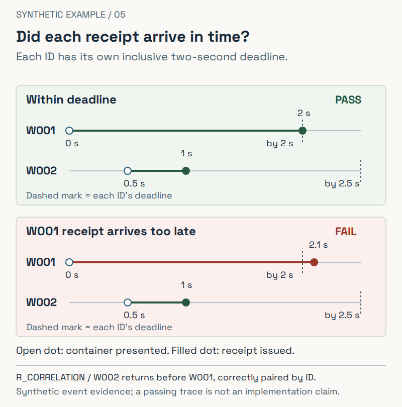](examples/readme-showcase/README.md#receipt-deadlines)

#### Quantity bounds

[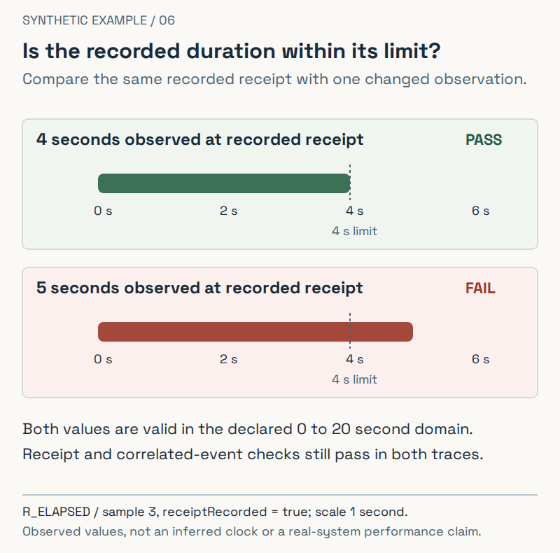](examples/readme-showcase/README.md#quantity-bound)

#### A blocked handoff

[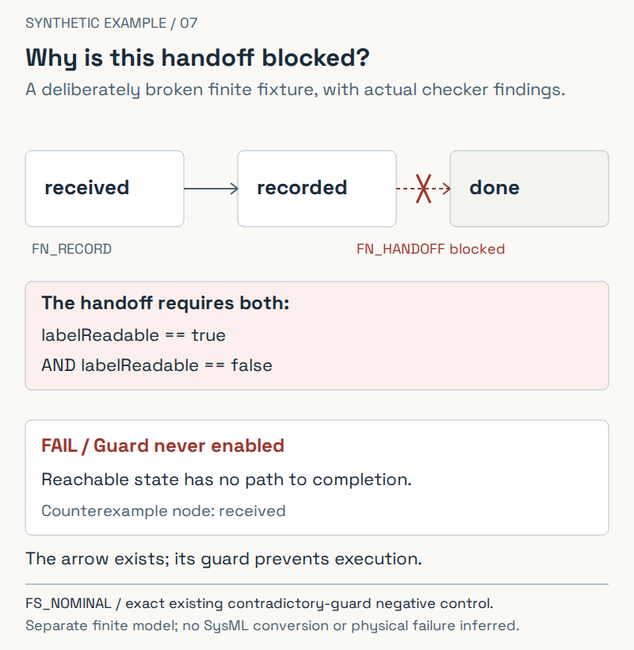](examples/readme-showcase/README.md#blocked-handoff)

#### Alternative approaches

[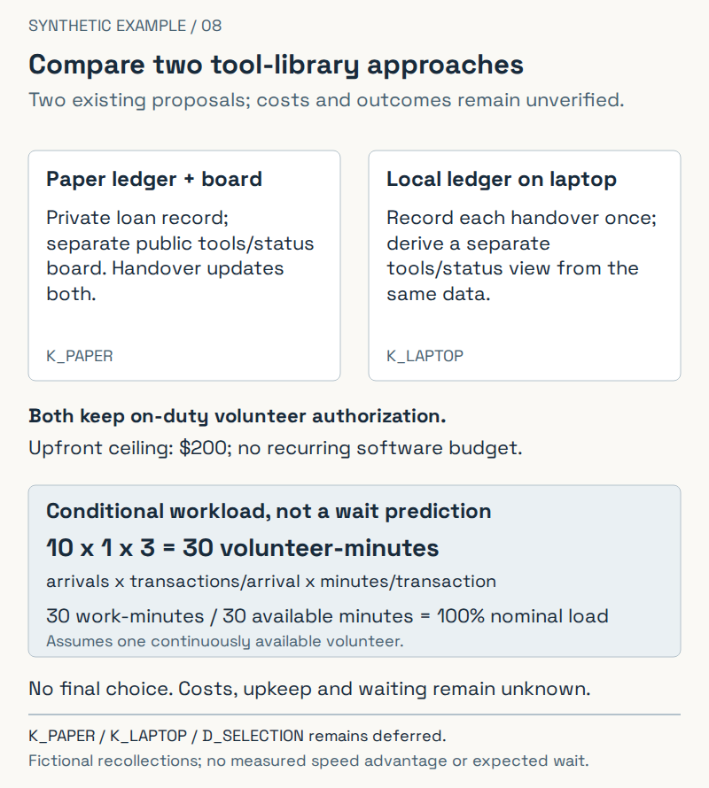](examples/readme-showcase/README.md#tool-library)

These eight PNGs retain their original rendering receipts. Their source SVGs and bound facts are reproduced by the current checks. Open the [full-size gallery](examples/readme-showcase/README.md) for details; dense previews lose readability when reduced to a narrow screen.

</details>

## What a result tells you

For supported questions, code evaluates the supplied inputs and returns findings you can inspect. These deterministic checks cover native parsing and references, selected configuration reconciliation, declared review coverage, supplied-trace monitoring, and separately authored finite-model analyses. The [capability matrix](docs/capability-completion.md) and [configuration contract](docs/configuration-review.md) define their respective boundaries.

Reports distinguish passing and failing checks from unknown, unsupported, incomplete, or errored work. A pass applies to the named check, retained scope, supplied inputs, and limits. Model links alone do not establish that a need is met. A connected view does not execute exchanges or demonstrate an installed system.

Real-world feasibility, source truth, protocol compatibility, stakeholder acceptance, and professional judgment still need appropriate evidence and review. General native SysML behavior execution and protected acceptance are outside this alpha.

## Get started

Clone the repository, open it in Codex, and try a request above. All four skills are independently available from this checkout: system concept, concept of operations (CONOPS), operational scenarios, and engineering diagrams.

```bash
git clone https://github.com/ajhcs/computable-systems-engineering.git
cd computable-systems-engineering
python3 scripts/install_sysml_parser.py
```

The parser setup needs Python 3.10+ and Java/`javac` 21+ on Linux and downloads the pinned upstream SysML pilot. If you only want to explore the documentation, no parser installation is needed. The shared runtime is also packaged as a complete local-executor plugin; user-scope installation through a local Codex marketplace has been tested. Public marketplace listing and native Windows execution remain unqualified.

[Setup and commands](docs/technical-guide.md) · [First concept/scenario trial](docs/end-user-test.md) · [Current-system views](docs/configuration-system-view.md) · [Contributing](CONTRIBUTING.md)

## Explore further

- [Concept review](docs/concept-review.md): keep expected coverage separate from the candidate.
- [Human tasks](docs/human-task-review.md) and [ownership](docs/ownership-review.md): make relevant people, responsibilities, and evidence gaps explicit.
- [Source-grounded references](docs/reference-library.md): selected TMT, APE, NASA, and NIST readings with provenance and limits.
- [Local prototype verification](docs/prototype-evaluation.md): connect selected prototype captures to supported checks.
- [Roadmap and engineering brief](docs/first-version-brief.md): understand the intended development and deferred work.

Project code is [MIT licensed](LICENSE). The separately downloaded SysML pilot and bundled fonts retain their own terms and notices. See the [release handoff](docs/release-handoff.md) for publication history.
