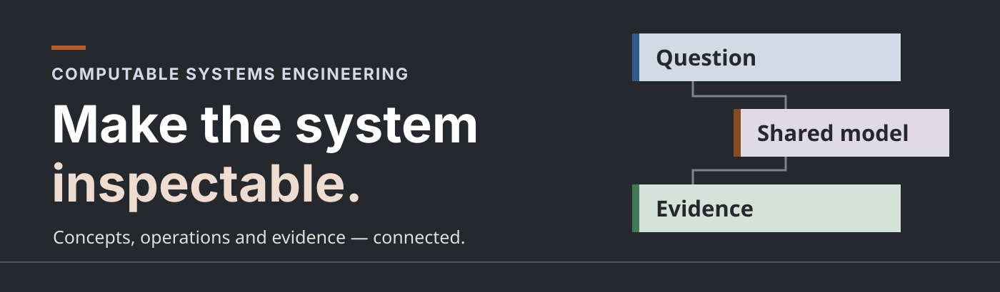

# Computable Systems Engineering

Turn an idea, an operating story, or a requirement into something you can inspect: a connected model, a readable view, and checks that show what passes, fails, or remains unknown. Ask in plain language. The assistant handles model files and commands; **you decide what the system should do**.

[Start with an example](#make-the-idea-concrete) · [Check evidence](#check-a-claim-against-explicit-evidence) · [Explore the sources](#explore-or-reproduce-the-outputs) · [Setup and technical guide](#installation-and-technical-guide)

**Start here:** open this repository in Codex and copy a request below. The skills help you develop a system concept, investigate a concept of operations, explore a particular operational scenario, or render a source-grounded engineering diagram. This is an alpha with [defined capabilities and limits](docs/capability-completion.md).

The examples use two fictional services: a sample-handoff station and a community tool library. Their people, equipment, limits, and observations are demonstration choices. Each preview links to a full-size view, with editable model and evidence links in its guide. On small screens, open the full-size view to read the detail. The PNGs and browser-inspection records are from an earlier rendering; the current integration reproduced their source SVGs byte for byte.

## Make the idea concrete

### Show the work the system needs to do

```text
Use the system-concept skill with this repository's water-sampling station example.
Show the main functions in plain language, then let me explore the detailed breakdown.
Keep the current model meaning and show unresolved choices.
```

[](examples/engineering-gallery/water-sampling/generated/function-tree/index.html)

This overview shows the main responsibilities. The [full function tree](examples/engineering-gallery/water-sampling/generated/function-tree/index.html) adds eight detailed functions; the branches show decomposition, not execution order. [Edit the model](examples/engineering-gallery/water-sampling/station.sysml).

## Walk through a normal day—and a difficult one

### Follow a sample from intake to pickup

```text
Use the operational-scenarios skill with the water-sampling station example.
Walk me through the nominal handoff. Show who sends what, in what order,
and link the picture to the selected scenario.
```

[](examples/readme-showcase/generated/01-normal-handoffs.svg)

Read the exchanges in order to see how a receipt and custody record connect the handoffs. This is a documentary scenario reading. [Full view and sources](examples/readme-showcase/README.md#normal-handoffs).

### Make the recovery path visible

```text
Use the operational-scenarios skill with the water-sampling station example.
Show the missing-label hold and recovery. Make the unresolved identity visible
and preserve the distinction between a receipt and permission to release.
```

[](examples/readme-showcase/generated/02-label-recovery.svg)

The held receipt records the problem. Identity correction and release authority remain distinct. [Full view and sources](examples/readme-showcase/README.md#label-recovery).

### See who is responsible for each function

```text
Use the CONOPS skill with the water-sampling station example.
Show the declared responsibilities
and make the scope of each assignment easy to inspect.
```

[](examples/readme-showcase/generated/03-responsibilities.svg)

These assignments explain the example's intended responsibilities. They are documentary allocations, with source links for review. [Full view and sources](examples/readme-showcase/README.md#responsibilities).

### Connect the need to the requirement

```text
Use the system-concept skill with this repository's water-sampling station example.
Show how the declared needs, requirements and use cases connect.
Keep the relationship types visible so I can inspect what each link means.
```

[](examples/readme-showcase/generated/04-need-traces.svg)

Follow an identified relationship back to its model elements. A declared link records a connection for review; it does not establish that a need has been met. [Full view and sources](examples/readme-showcase/README.md#need-traces).

## Check a claim against explicit evidence

### Find the receipt that arrived too late

```text
Use the operational-scenarios skill with the water-sampling example.
Check its supplied pass and late event traces against the correlated receipt deadline.
Show the on-time boundary, the late response and which request each receipt answers.
```

[](examples/readme-showcase/generated/05-receipt-deadlines.svg)

The event monitor matches receipts to request IDs, including responses that arrive out of order. The result applies to these supplied synthetic traces. [Full view, evidence and reports](examples/readme-showcase/README.md#receipt-deadlines).

### Inspect both sides of a quantity limit

```text
Use the operational-scenarios skill with the water-sampling example.
Compare the supplied receipt-time observations of four and five seconds
against the declared quantity limit. Show which requirement changes result.
```

[](examples/readme-showcase/generated/06-quantity-bound.svg)

Four seconds meets the declared bound. Five seconds fails that clause while the separate receipt deadlines still pass. These are supplied observations. [Full view, evidence and reports](examples/readme-showcase/README.md#quantity-bound).

### Understand why a handoff cannot complete

```text
Use the operational-scenarios skill with the water-sampling example.
Explain its deliberate blocked-handoff test using the separate finite model.
Show the disabled step, the reported finding and the condition that caused it.
```

[](examples/readme-showcase/generated/07-blocked-handoff.svg)

This deliberately altered finite model demonstrates a diagnostic. It is separate from the native SysML scenario and from observed station behavior. [Full view, model and report](examples/readme-showcase/README.md#blocked-handoff).

## Compare an approach while keeping unknowns visible

### Put alternatives and a capacity calculation side by side

```text
Use the system-concept skill with this repository's community tool-library example.
Compare the paper and laptop alternatives, keep the selection open,
and explain the conditional capacity calculation alongside its unknowns.
```

[](examples/readme-showcase/generated/08-tool-library.svg)

The illustrative assumptions consume 30 work-minutes in a 30-minute window. The alternatives' evidence gaps remain visible; the arithmetic does not predict actual waiting time. [Full view, concept and calculation](examples/readme-showcase/README.md#tool-library).

## Explore or reproduce the outputs

Open the [preview gallery and editable sources](examples/readme-showcase/README.md), the [connected station walkthrough](examples/engineering-gallery/water-sampling/README.md), or the [capability matrix](docs/capability-completion.md). For your own material, ask a skill to investigate a focused question and keep unresolved evidence visible. Keep private sources out of Git.

The [source-grounded reference library](docs/reference-library.md) also offers selected TMT, APE, NASA and NIST views, with source links, notices and explicit limits. Original raw model files remain separate.

## Installation and technical guide

<details>
<summary>Open setup commands, supported semantics, existing examples, and implementation details</summary>

Three independently invocable drafting skills help a systems engineer develop a system concept, a concept of operations (CONOPS), or an operational scenario. A fourth supports source-grounded diagrams. The engineer directs consequential decisions; the assistant helps investigate, draft, run checks, and revise.

**Status: alpha.** The three drafting skills default to authoring SysML v2 textual models for new recorded work. A pinned upstream pilot parser validates those models. A bounded controlled-text profile checks selected sampled Boolean/quantity requirements and correlated event deadlines against supplied evidence. A separate bounded generator exports synthetic pass/fail trace pairs that demonstrate a referenced property's effect on one sampled requirement when it can find such a pair. Existing version-1 JSON helpers and the opt-in finite verifier remain available. General SysML behavior computation, temporal realizability, formal FLIP coverage, hosted Jev integration, and protected acceptance are not implemented. The project source is offered under the [MIT license](LICENSE); the separately downloaded pilot parser has its own license. Publication details are tracked in [the release handoff](docs/release-handoff.md).

| Skill | Useful work unit |
|---|---|
| `develop-system-concept` | Frame a problem, identify functions, explore alternatives, and assess evidence for a concept decision. |
| `develop-conops` | Connect stakeholder needs, boundaries, scenarios, responsibilities, and evaluation plans. |
| `develop-operational-scenarios` | Develop or investigate one scenario or a selected set. |
| `generate-engineering-diagrams` | Produce or review views from established engineering meaning and supporting evidence. |

A complete document is optional. Missing information can remain an explicit unknown. The skills use a system-wide SysML model and selected views rather than requiring the entire model in every model context. The [SysML-first profile](docs/sysml-v2-profile.md) defines the supported parser and checker boundary.

For a recorded concept, a [project-tailored review](docs/concept-review.md) compares the candidate with a separately retained scope. Related workflows cover [human tasks](docs/human-task-review.md), [ownership](docs/ownership-review.md), [behavior claims](docs/behavior-review.md), and [conditional resource questions](docs/inquiry-profile.md). These are bounded checks and investigations; their results do not establish staffing, feasibility, observed system behavior, or engineering acceptance.

The [diagram-generation skill](skills/generate-engineering-diagrams/SKILL.md) helps turn accepted model meaning into a source-linked view. Explore the [synthetic station walkthrough](examples/engineering-gallery/water-sampling/README.md) or the [source-grounded references](docs/reference-library.md). Native-editor round-trip, complete graphical conformance, and behavioral simulation remain separate, unverified outcomes.

## Explore a connected engineering example

The [water-sampling station walkthrough](examples/engineering-gallery/water-sampling/README.md) follows a fictional sample from intake to recorded receipt, through a missing-label hold and recovery, and into maintenance lockout. It brings together editable source, readable views, typed traces and actual program outcomes. Its thresholds and evidence are demonstration choices, not a design approved for real equipment.

| Start with | Explore or edit | What you can check |
| --- | --- | --- |
| [Concept and operating model](examples/engineering-gallery/water-sampling/station.sysml) | Parts, concerns, functions, operational cases and declared requirements | Native syntax/reference validation and each requested drafting shape |
| [Readable artifact browser](examples/engineering-gallery/water-sampling/generated/index.html) · [gallery guide](examples/engineering-gallery/README.md) | Scoped overview, full function tree, nominal/recovery/maintenance exchanges and model links | Selected native bindings and documentary view structure; inspect detailed diagrams at readable scale |
| [Synthetic observation trace](examples/engineering-gallery/water-sampling/evidence-pass.json) · [required clause scope](examples/engineering-gallery/water-sampling/scope.json) | Sampled recording, exact duration bounds and correlated receipts | Named finite-window monitor results, late/missing/incomplete controls and clause-local synthetic influence tests |
| [Finite execution model](examples/engineering-gallery/water-sampling/finite-scenarios.json) · [independent scope](examples/engineering-gallery/water-sampling/finite-scope.json) | Explicit guards, effects, typed data availability, external waits and completion | Finite consistency, reachable failures and declared completion paths; this is separately authored, not an executable SysML conversion |
| [Meaning and scope mapping](examples/engineering-gallery/water-sampling/semantic-ledger.json) · [method and official definitions](docs/gallery-method.md) | Responsibility, source/view identities, assumptions and omitted semantics | Typed correspondence and trace structure; links alone do not prove satisfaction or physical feasibility |

Run the case from a complete checkout after installing the pinned parser:

```bash
python3 examples/engineering-gallery/water-sampling/build.py --output work/water-sampling
python3 examples/engineering-gallery/water-sampling/build.py --check
```

Use a new output directory for each generation. The check reruns supported computations and compares the committed artifacts with their source bindings. Expected failures remain visible: a late receipt fails, an unfinished observation remains unknown, and deleted or unclassified finite-review obligations cannot disappear from a supplied external scope. See the case guide for exact inputs, outcomes and limits. The [existing tool-library example](examples/tool-library/README.md) adds a legacy concept comparison and conditional capacity calculation without claiming observed performance.

## Capability status and review

The [completion and verification matrix](docs/capability-completion.md) maps the architecture to implemented checks, executable examples and deferred capabilities. The current finite verifier also accepts an optional independent inventory:

```bash
python3 scripts/verify.py examples/engineering-gallery/water-sampling/finite-scenarios.json \
  --manifest examples/engineering-gallery/water-sampling/finite-scope.json --review --json --detail
```

Scenario analyses now run even when requirement applicability is unsupported; a definite dead-end failure survives an exploration cap alongside the incomplete result. Reports identify the scenarios actually analyzed. A focused review still checks global declarations, requirement consistency, traces and the supplied scope. Manifest-free legacy invocations remain available, with no independent inventory guarantee.

Native parsing, supplied-trace monitoring, finite state exploration, documentary allocations and engineering acceptance are separate claims. Native expression execution, unrestricted scenario compilation, realizability, full SysML conformance and protected acceptance remain outside this alpha. No global plugin installation or native-editor roundtrip is implied by the gallery.

## Interaction walkthroughs

When people interact with a proposed system or interpret an operational handoff, inspect relevant professional/UI precedents and use editable connected low-fidelity wireframes to expose consequential fields, options, defaults, actions, states and recovery. Keep source/model/requirement mappings adjacent and iterate with user feedback before substantial expansion, polish or implementation. The [interaction-walkthrough workflow](docs/interaction-walkthroughs.md) defines coverage, research provenance and review boundaries; current alpha limits remain separate from target product needs.

## Try the current helpers

Computed checks require a local executor. The shared SysML runtime is qualified on Linux with Python 3.10 or newer and Java/`javac` 21+; native Windows SysML execution is unsupported. Version-1 helpers use only the Python standard library. SysML also needs the pinned pilot parser. For an installed or read-only copy, set `CSE_SYSML_CACHE` to a private writable directory outside the plugin; source checkouts default to ignored `.cache/sysml`. Run from this repository:

```bash
python3 scripts/check.py
python3 scripts/install_sysml_parser.py
python3 scripts/check.py --require-sysml
python3 scripts/sysml.py examples/sysml/concept.sysml --syntax-only
python3 scripts/sysml.py examples/sysml/conops.sysml --syntax-only
python3 scripts/sysml.py examples/sysml/scenario.sysml --syntax-only
python3 scripts/sysml.py examples/sysml/ack.sysml --manifest examples/sysml/ack-manifest.json --evidence examples/sysml/ack-evidence.json --review
python3 scripts/sysml_testgen.py examples/sysml/ack.sysml --manifest examples/sysml/ack-manifest.json --output .tmp/ack-synthetic-tests.json
python3 scripts/sysml.py examples/sysml/correlated-events.sysml --manifest examples/sysml/correlated-events-manifest.json --evidence examples/sysml/correlated-events-evidence.json --review
python3 scripts/sysml.py examples/sysml/quantity.sysml --manifest examples/sysml/quantity-manifest.json --evidence examples/sysml/quantity-evidence.json --review
python3 scripts/sysml.py examples/sysml/composed-parts.sysml examples/sysml/composed-requirement.sysml --manifest examples/sysml/composed-manifest.json --evidence examples/sysml/composed-evidence.json --review
python3 scripts/sysml_view.py examples/sysml/ack.sysml --id R_ACK
python3 scripts/sysml_diff.py --before examples/sysml/ack.sysml --after examples/sysml/quantity.sysml
python3 skills/develop-conops/scripts/conops.py check examples/workshop/conops.json --review
python3 skills/develop-operational-scenarios/scripts/conops.py view examples/workshop/conops.json S1
python3 skills/develop-system-concept/scripts/concept.py --help
python3 scripts/verify.py examples/verifier/valid.json --review
python3 scripts/verify.py examples/verifier/valid.json --scenario S1 --review --json --detail
```

On systems where Python is named `python`, substitute that executable. Each skill's `references/sysml.md` describes new model output; `references/record.md` preserves its legacy JSON contract. The SysML integration tests run when the pinned parser is installed; otherwise they report a skip. The `--require-sysml` check and CI fail if the pinned parser is missing or stale.

The workshop example is synthetic. Passing its checks establishes only the conditions that the helper actually checks. Textual feasibility assessments, source truth, stakeholder acceptance, and implemented-system behavior are not independently verified.

The [synthetic tool-library example](examples/tool-library/README.md) includes a system-concept record, a human view, and a small reproducible calculation. It illustrates explicit unknowns and engineer decisions without creating a full CONOPS.

The [version-2 contract](docs/verifier-v2.md) and [synthetic fixture](examples/verifier/valid.json) specify the finite semantics. Use `--scenario S1 --view` to retrieve a context slice, while running checks against the full model. The [FHWA slice](docs/fhwa-merge-slice.md) is an unaccepted formalization proposal. [FRET reuse](docs/fret-spike.md), [context measurement](docs/context-measurement.md), and the separate [protected-runner boundary](docs/protected-runner.md) record limits and next work.

The optional [engineering view-quality checks](docs/engineering-view-quality.md)
validate declared function roots/levels/parent links and ordered participant
exchanges, with task-specific counts, coverage, timing, and justified exceptions.
The skills assess action meaning and engineering adequacy with the engineer;
structural acceptance does not establish either. Existing unannotated models
retain their current checks. Try the neutral fixture with
`python3 scripts/sysml.py examples/sysml/views/sample-handling.sysml --syntax-only --view-profile examples/sysml/views/task-profile.json`.

## Use the skills

The repository registers its four skills through symlinks under `.agents/skills/`, which Codex discovers when you open this project. They remain independently invocable and are scoped to this repository. Start a new project conversation if the skill selector has not refreshed. [Codex skill discovery](https://learn.chatgpt.com/docs/build-skills) documents repository scope and symlink support.

Each drafting skill's `scripts/cse.py` launcher finds the shared parser/engine from its real location, so checks work from subdirectories as well as the repository root. The portable plugin manifest is `plugin.json`, with `.codex-plugin/plugin.json` for compatibility. Both declare the local executor requirement. Installation through a public marketplace remains untested. Copying a drafting skill folder alone preserves its version-1 helper, but does not install the shared SysML engine. Avoid duplicate installations.

Example requests:

- “Use the system-concept and CONOPS skills on the material below. Keep my raw materials out of Git.” In this repository, the assistant uses both skills on one model, runs both draft-shape checks, and inspects supported sampled requirements with synthetic test pairs. It reads raw source in place and keeps the source and user-specific model in ignored private workspace paths; the engineer supplies material and reviews consequential interpretations, not commands or SysML syntax.
- “Use develop-system-concept to help compare these two approaches. Keep the current constraints and show unresolved evidence.”
- “Use develop-conops to investigate who operates and maintains this service.”
- “Use develop-operational-scenarios to develop the communications-loss scenario only.”

For your first combined concept/scenario trial, use “Use the system-concept and operational-scenarios skills on the material below. Keep my raw materials out of Git.” The assistant creates one shared model, returns readable concept and scenario views, runs both relevant draft checks, and reports supported computations separately from unresolved content. User-specific work stays in ignored `work/`. No command or SysML knowledge is required from the engineer. See the [end-user test guide](docs/end-user-test.md), [pre-test review](docs/pre-test-review.md), and [synthetic shared example](examples/sysml/joint-concept-scenario.sysml).

## Build the next version

Start with [the first-version brief](docs/first-version-brief.md), [the model and verification design](docs/model-and-verification.md), and [the implementation prompt](docs/kickoff-prompt.md). The brief separates agreed objectives from implementation defaults and defines evidence required for completion.

The [SysML-first plan](docs/sysml-v2-model-first-plan.md) and [implemented alpha profile](docs/sysml-v2-profile.md) describe the current migration and its limits. The [public-source evaluation](docs/public-sysml-evaluation.md) shows FHWA and NASA candidate slices with synthetic traces. The [controlled language profile](docs/requirements-language-v1.md) parses a narrow FRET-inspired subset and checks supplied sampled behavior using explicit clock and unit semantics. [Variable-influence tests](docs/variable-influence-tests.md) are a bounded precursor to formal FLIP generation. The parsed context view and structural diff support review, but general state/mode computation, FRET-backed test generation, and richer generated views remain future work.

The project uses deterministic program results for computable claims. Broader validation still requires evidence and engineering judgment. JSON is a transport format, not a token-efficiency claim; measure context and repair costs before making such claims.

See [public references](docs/references.md) and [contribution guidance](CONTRIBUTING.md). External publications and tools remain under their own terms; none is bundled here.

## Experimental visual presentation

An opt-in checked documentary function-tree renderer adds palette03, embedded Inter/Space Grotesk fonts and explicit provisional body variants. See [visual presentation](docs/visual-presentation.md) for generation, editable sources, checks and limits. Existing checking defaults remain unchanged.

</details>
