[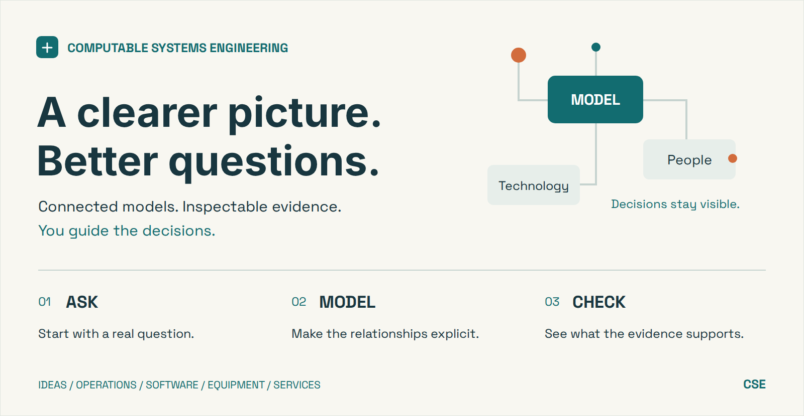](assets/readme/cse-overview.svg)

# Computable Systems Engineering

**Move from a systems engineering question to a connected model, useful views, and evidence you can inspect.**

Computable Systems Engineering (CSE) is an alpha toolkit for AI-assisted model-based systems engineering (MBSE). Its eleven Codex skills help an engineer explore concepts, operations, architecture, measures, and evidence; produce source-linked diagrams; and run deterministic checks where the model and evidence have supported semantics. New recorded concept and operational work uses textual SysML v2, while existing version-1 records remain available. You can begin with a question and existing project material; you do not need to write SysML to start a conversation.

CSE is useful for a service involving people and software, a piece of equipment, a laboratory operation, or another system with interacting parts. The assistant can organize work, prepare model changes, invoke local tools, and explain findings. **The engineer decides** accepted intent, scope, applicability, units, thresholds, obligations, selection, and acceptance. Inferred requirements or consequential changes are proposals for review.

**Version 0.2.0-alpha.6 · Local execution · [MIT project license](LICENSE)**

[Start with a question](#start-with-the-question-that-matters-to-you) · [Set up the checkout](#get-started) · [Choose a skill](#choose-a-skill) · [Explore the examples](#examples-you-can-open-and-inspect) · [Understand results](#what-a-result-tells-you)

## Start with the question that matters to you

| Your question | A useful place to start | What you can inspect |
| --- | --- | --- |
| What problem are we solving, and what could meet the need? | [Develop a system concept](skills/develop-system-concept/SKILL.md) | Needs, functions, alternatives, assumptions, and unresolved decisions |
| How does work proceed, including a disruption? | [Develop an operational scenario](skills/develop-operational-scenarios/SKILL.md) | Participants, exchanges, conditions, handoffs, and recovery |
| What is connected in the selected design? | [Develop system architecture](skills/develop-system-architecture/SKILL.md) | Parts, interfaces, allocations, selected identities, and missing mappings |
| How would we know a claim is true? | [Plan engineering evidence](skills/plan-engineering-evidence/SKILL.md) | A claim, method, operating conditions, evidence, and the decision it supports |
| Does a calculation, observation, or modeled behavior agree with the stated conditions? | [Select a bounded analysis](#analyze-a-connected-engineering-question) | Inputs, scope, actual findings, counterexamples, and limits |

One discussion or one scenario can be the whole task. A concept and scenario request does not require a complete CONOPS, and qualitative intent need not become an executable requirement merely to be useful.

## Try it with Codex

Open the checkout as a Codex project and start a new conversation. The repository registers the eleven skills under [`.agents/skills/`](.agents/skills/). Natural activity names are sufficient; the assistant handles the relevant model files and commands.

**Explore an idea**

```text
Help me develop a concept for a shared equipment service. Identify the people,
functions, alternatives, and evidence we need. Keep assumptions visible and
leave consequential choices for me to review.
```

**Investigate an exception**

```text
Use the operational-scenarios skill with the water-sampling station example.
Show the normal handoff and the missing-label recovery. Explain who does what,
what information moves, and what still needs evidence.
```

**Work across an existing project**

```text
Use coordinate-engineering-work on my project material. Preserve the current
model and decisions. Review the selected interface and its recovery scenario,
identify missing evidence, and run the checks that apply.
```

For your own work, provide the question, relevant material, and any accepted decisions or constraints. Say which sources and model revision govern if there are competing versions. Keep private materials, project-specific models, and reports in private project storage and out of Git; ignored directories help prevent ordinary staging but are not an access-control boundary. The assistant should report unavailable tools or evidence rather than presenting an unrun check as a result.

## Get started

### Requirements and checkout

For native SysML parsing and checks, use a **Linux local executor**, Python **3.10 or later**, and Java **and `javac` 21 or later**. The installer downloads and verifies the pinned OMG SysML v2 Pilot archive. Documentation and some standard-library helpers can be used without the parser; the native parser route does not currently support Windows.

```bash
git clone https://github.com/ajhcs/computable-systems-engineering.git
cd computable-systems-engineering
python3 scripts/install_sysml_parser.py
python3 scripts/sysml.py examples/sysml/concept.sysml --syntax-only --kind concept
```

The last command parses a synthetic concept and checks its minimum draft shape. It does not establish that the concept is complete or feasible. The parser's upstream code and libraries are downloaded separately under their own terms. The [SysML profile](docs/sysml-v2-profile.md#install-and-run) describes the pinned version, cache, and native-check boundary.

Run the regression suite from the repository root:

```bash
python3 scripts/check.py --require-sysml
```

`--require-sysml` makes a missing or stale parser a failure. Without it, unavailable native tests can be skipped; read the reported skips. Full development qualification also uses the optional pinned symbolic calculation dependencies in [requirements-analysis.txt](requirements-analysis.txt). Install them in a project virtual environment using a Python distribution with `venv` and `pip` available:

```bash
python3 -m venv .venv
. .venv/bin/activate
python3 -m pip install -r requirements-analysis.txt
python3 scripts/check.py --require-sysml
```

The [setup and technical guide](docs/technical-guide.md) contains further commands and examples. For an installed or read-only runtime, set `CSE_SYSML_CACHE` to a private writable directory outside the plugin and keep the same setting for parser setup and checks. For a source checkout, the default is its ignored `.cache/sysml` directory.

### Using the skills outside this checkout

The complete runtime is also packaged as a local-executor plugin. A user-scope installation through a **separately configured local Codex marketplace** has been tested. The repository supplies plugin metadata but does not itself include a marketplace listing; a public marketplace installation is not established.

If your configured marketplace contains a reviewed CSE package, replace `LOCAL_MARKETPLACE` with its name:

```bash
codex plugin marketplace list
codex plugin list --marketplace LOCAL_MARKETPLACE --available --json
codex plugin add computable-systems-engineering@LOCAL_MARKETPLACE
```

Start a fresh conversation and verify skill discovery. Copying an individual drafting skill alone does not install the shared SysML engine. See the [technical guide](docs/technical-guide.md#use-the-skills) and [release handoff](docs/release-handoff.md).

## How the work fits together

1. **Frame the question.** Identify the decision, system boundary, sources, and what is already accepted. A focused question can start with a small part of an existing project.
2. **Develop one connected model.** Relate the relevant concerns, functions, participants, interfaces, scenarios, requirements, and evidence. Multiple skills can work on the same model and run their respective checks. Record uncertain interpretations and proposed changes so the engineer can decide them.
3. **Select a view and an independent scope.** A readable concept, scenario, architecture view, or diagram exposes the chosen part of the work. A retained review scope records what must be checked separately from the candidate being reviewed. A smaller view does not remove obligations from the check.
4. **Run the applicable checks and review the work.** Deterministic tools evaluate supported representations and supplied evidence. Read their findings and the actual delivered text, code, or view against the source meaning. Repair ordinary defects within accepted intent, retain unresolved findings, and propose changes that would alter an engineering decision.

The shared model is a durable representation, while documents and diagrams are scoped views of it. A label match alone does not establish identity, a trace link alone does not prove satisfaction, and a successful parse does not execute a scenario. See [meaning and context](docs/meaning-context.md) for the source, identity, condition, goal, and evidence distinctions used during drafting and review.

## Choose a skill

Each skill is independently invocable. Use coordination when a question crosses several activities; use a focused skill when one activity is enough.

| Skill | Use it to… | Typical result or next step |
| --- | --- | --- |
| [Coordinate engineering work](skills/coordinate-engineering-work/SKILL.md) | Connect a question across concepts, architecture, scenarios, measures, evidence, and views. | A shared work slice and the relevant selected checks. |
| [Develop a system concept](skills/develop-system-concept/SKILL.md) | Investigate the problem, desired outcomes, functions, and alternatives. | A concept view, proposals, evidence gaps, or a decision comparison. |
| [Develop a CONOPS](skills/develop-conops/SKILL.md) | Connect stakeholder needs, system boundaries, operations, responsibilities, and evaluation. | A scoped operating concept and its open questions. |
| [Develop operational scenarios](skills/develop-operational-scenarios/SKILL.md) | Describe or investigate normal operation, exceptions, recovery, or lifecycle work. | Selected scenarios and exchanges, with assumptions and missing information. |
| [Develop system architecture](skills/develop-system-architecture/SKILL.md) | Work through functions, parts, interfaces, or allocations. | A connected architecture slice and correspondence to existing meaning. |
| [Define engineering measures](skills/define-engineering-measures/SKILL.md) | Define what is measured, how it is collected, and what a baseline means. | A measure definition with units and collection conditions. |
| [Plan engineering evidence](skills/plan-engineering-evidence/SKILL.md) | Choose methods to verify a specified requirement or validate intended use. | An evidence plan tied to a claim and decision. |
| [Analyze queues](skills/analyze-queues/SKILL.md) | Investigate waiting and utilization for a stated workload or conditional M/M/c model. | A bounded calculation with input and distribution assumptions. |
| [Analyze system failures](skills/analyze-system-failures/SKILL.md) | Analyze an explicit Boolean fault tree or check an FMEA record. | Findings for the supplied failure model and assumptions. |
| [Check engineering language](skills/check-engineering-language/SKILL.md) | Review selected terminology and supported controlled-English rules. | Specific language findings and meaning-preserving repair proposals. |
| [Generate engineering diagrams](skills/generate-engineering-diagrams/SKILL.md) | Create or review a view from established meaning, or find reusable visual components. | A source-linked view, editable graphic, and stated omissions. |

The skills' `SKILL.md` files and their linked references describe inputs and methods. The [capability matrix](docs/capability-completion.md) maps implemented checks to examples and deferred work.

## Analyze a connected engineering question

A check is useful when its input representation and result match the question. The following routes use different contracts; none supplies missing engineering intent automatically.

| Question | Supported route | What to keep with the result |
| --- | --- | --- |
| Do declared equations, units, functions, or flows agree? | [Calculations and function/flow checks](docs/engineering-analysis.md) | The authored relationships, units, and supported calculation scope. |
| What do supplied samples or correlated events establish? | [Sampled and event behavior checks](docs/behavior-review.md) | An independent obligation manifest, observation boundary, timing, and completeness. |
| Can an explicitly modeled finite scenario reach a declared outcome? | [Finite verifier](docs/verifier-v2.md) | Authored states, guards, effects, external changes, obligations, and analysis limits. |
| What does an observation mean, or has a measure changed? | [Measure definitions](docs/measurement-definitions.md) and [observation calculations](docs/observation-validation.md) | Units, collection conditions, data, and baseline meaning. |
| Where can work wait, or how do modeled failures combine? | [Queue analysis](docs/queue-analysis.md) and [failure analysis](docs/failure-analysis.md) | Workload or fault model, probabilities where used, and assumptions. |
| What needs rechecking after a change, and are outputs current? | [Dependency impact](docs/impact-analysis.md) and [artifact freshness](docs/artifact-freshness.md) | Selected dependencies, source revisions, and retained artifacts. |

For example, these commands review a synthetic sampled trace and a separately authored finite model:

```bash
python3 scripts/sysml.py examples/sysml/ack.sysml --manifest examples/sysml/ack-manifest.json --evidence examples/sysml/ack-evidence.json --review
python3 scripts/verify.py examples/verifier/valid.json --review --json --detail
```

The first checks supported clauses against supplied observations and includes this finding for the fixture:

```text
pass: supplied behavior evidence, 1 compiled obligation(s)
  R_ACK__responseTime: pass
```

The second explores the explicit finite contract and returns a JSON report with scope, obligations, limits, and findings. This legacy invocation does not supply an independent finite-review manifest; [the finite contract](docs/verifier-v2.md) explains how to add one. Neither command converts narrative SysML scenarios into executable behavior. The [water-sampling walkthrough](examples/engineering-gallery/water-sampling/README.md) connects both kinds of check to source models and negative controls.

### Retrieve the meaning needed for a question

An assembled context view can bring existing definitions, native identities, roles, typed relationships, conditions, qualitative goals, and linked evidence records together. It retains distinctions such as a planned test, a supplied assessment, and an executed observation. Inspect the returned coverage, omissions, unresolved mappings, and original statuses before relying on the view.

```bash
python3 scripts/sysml_view.py examples/meaning-context/handoff.sysml --profile examples/meaning-context/handoff.english.json --element S_HANDOFF --source SYN_HANDOFF=examples/meaning-context/brief.txt
```

The default output is the full assembled report. Add `--compact --max-bytes 50000` to request lossless pooling of repeated JSON values within a complete UTF-8 output budget. The supported limit is 1,024–8,000,000 bytes, including metadata and the final newline. `verifier.context_budget.expand_context` recovers the original report. If the entire report cannot fit, the command returns non-success; it does not silently omit definitions or narrow the required review. A successful transport can still contain an unknown or incomplete semantic result. The [context guide](docs/meaning-context.md#retrieve-an-assembled-view) documents selectors and expansion.

For directly authored language-version-1 sampled traces, discover the input shape first:

```bash
python3 scripts/sampled_trace.py schema
```

This returns a generic syntax example with `status: not_run`. To check observations, replace the placeholders below with the trace, an independently retained language scope, and the previously retained SHA-256 of that scope's exact bytes:

```bash
python3 scripts/sampled_trace.py trace TRACE.json --scope SCOPE.json --scope-sha256 RETAINED_SCOPE_BYTE_SHA256
```

Native SysML manifests and language scopes have different formats; the helper does not infer or convert obligations. See the [sampled-trace contract](docs/behavior-review.md#discover-the-sampled-trace-input-contract).

## What a result tells you

A deterministic **pass** applies to the named check, model revision, retained scope, supplied evidence, and stated limits. Reports distinguish failure from unknown, unsupported, incomplete, not-run, or error states where applicable. A missing observation, unexercised trigger, exceeded analysis limit, or failed required check cannot become a successful required review.

A plan is not an observation; a supplied assessment is not automatically a measured result. Synthetic traces exercise a checker but do not measure a real system. Verification against a stated requirement and validation for intended use are different questions. Source truth, physical feasibility, operational performance, stakeholder acceptance, and professional judgment need their own evidence and review.

CSE does not provide unrestricted natural-language parsing, general native SysML behavior execution, lossless SysML/Draw.io interchange, or a protected acceptance runner. Hashes identify supplied bytes and detect changes against retained values; they do not authenticate an engineer's decision or protect a scope and checker controlled by the same user. See [behavior review](docs/behavior-review.md), the [SysML profile](docs/sysml-v2-profile.md), and the [protected-runner boundary](docs/protected-runner.md).

A [24-run synthetic generation comparison](docs/context-generation-comparison.md) assessed actual outputs against retained source meaning. Independent model reviewers found eight essential omissions across seven of 96 output units; 708 fixed behavior cases passed separately, while all native monitor aggregates remained unknown. Generation and review used the same model family. The small study is an output assessment, not general reliability evidence or engineering acceptance.

## See the system you actually selected

A model can contain several systems and receivers of the same type. The current design depends on the selected instances and their actual connections, not just matching labels. CSE's configuration review compares supplied native identities and connections with a separately retained selection scope.

[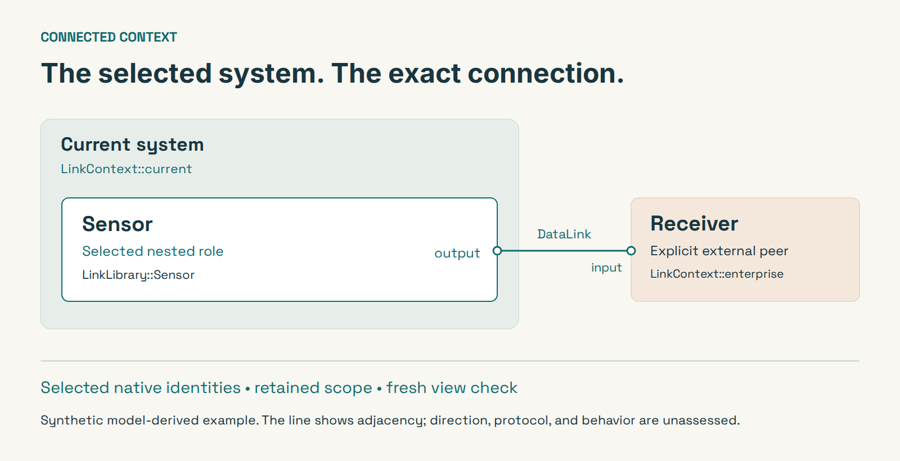](assets/readme/connected-overview.svg)

This explanatory illustration comes from a [two-file synthetic model](examples/configuration-review/connected/README.md) and its [retained scope](examples/configuration-review/connected/scope.json). It shortens labels and omits multiplicity. The ordinary connection represents undirected native adjacency; it does not establish data-flow direction or protocol compatibility.

[Editable illustration](assets/readme/connected-overview.svg) · [Checked system-view SVG](examples/configuration-review/connected/generated/system.svg) · [HTML reader](examples/configuration-review/connected/generated/index.html) · [View ledger](examples/configuration-review/connected/generated/view.json) · [Reconciliation contract](docs/configuration-review.md)

A saved picture can become stale. The [system-view guide](docs/configuration-system-view.md) describes how to compare it with a fresh reconciliation. The full native identities, diagnostics, and omissions remain in the derived view and ledger.

## Examples you can open and inspect

The following fictional sample-station and community tool-library examples show the relationship between source, view, and result. Their responsibilities, limits, and observations are demonstration choices, not approved real-world designs. The full [engineering gallery](examples/engineering-gallery/README.md) and [showcase guide](examples/readme-showcase/README.md) include editable SVGs, text alternatives, source links, and detailed qualifications. To use the full-size HTML reader, open it locally with its sibling files from the checkout. On narrow screens, scroll the reader rather than relying on a reduced preview.

### Understand the work

[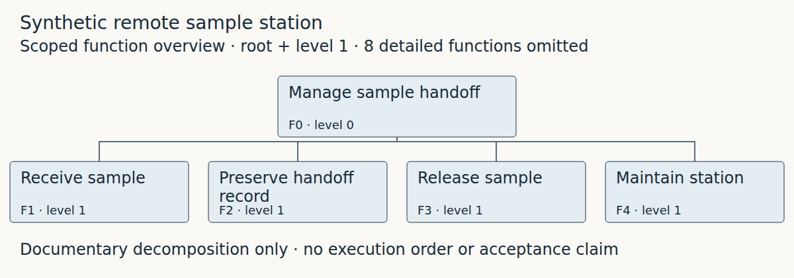](examples/engineering-gallery/water-sampling/generated/function-tree/index.html)

The [station walkthrough](examples/engineering-gallery/water-sampling/README.md) connects its [SysML model](examples/engineering-gallery/water-sampling/station.sysml), [semantic ledger](examples/engineering-gallery/water-sampling/semantic-ledger.json), sample observations, and separate finite model. A function tree shows decomposition; it does not establish that a function is implemented or effective.

### See the effect of a concrete check

These previews are source-linked explanatory presentations, not native SysML graphical notation. Open each title's linked example for its precise sources, editable SVG, and stated omissions.

<details>
<summary>Explore eight views and their evidence</summary>

#### Normal handoffs

[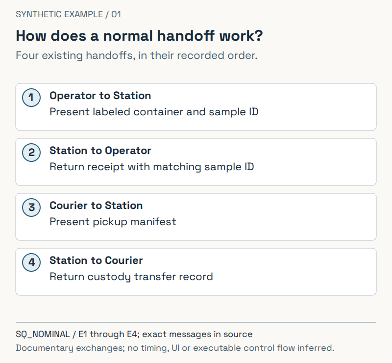](examples/readme-showcase/README.md#normal-handoffs)

Four documentary exchanges show who sends what to whom. [Source, SVG, and text alternative](examples/readme-showcase/README.md#normal-handoffs).

#### Missing-label recovery

[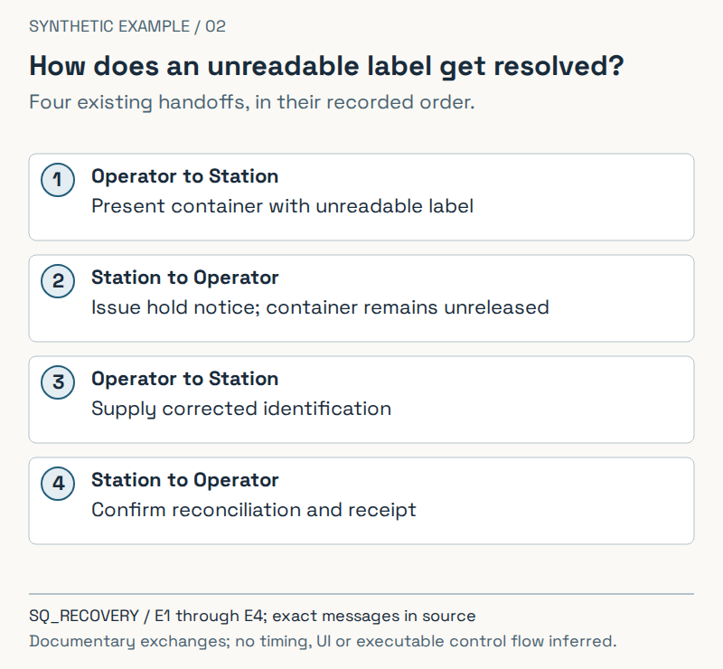](examples/readme-showcase/README.md#label-recovery)

The example keeps the container unreleased during the hold. [Source, SVG, and text alternative](examples/readme-showcase/README.md#label-recovery).

#### Responsibilities

[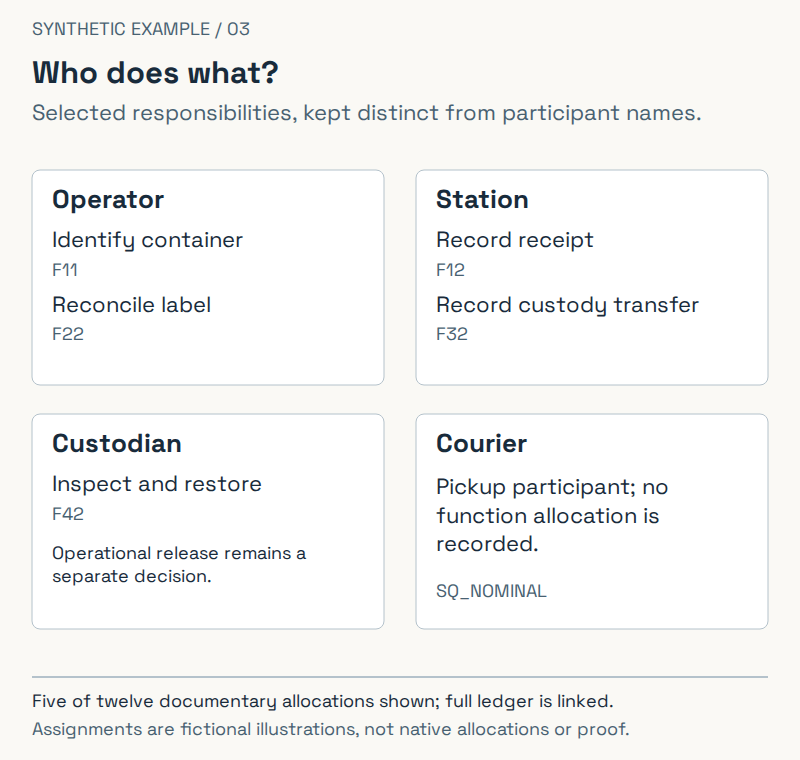](examples/readme-showcase/README.md#responsibilities)

The selected documentary assignments do not establish implementation ownership. [Source, SVG, and text alternative](examples/readme-showcase/README.md#responsibilities).

#### Needs and requirements

[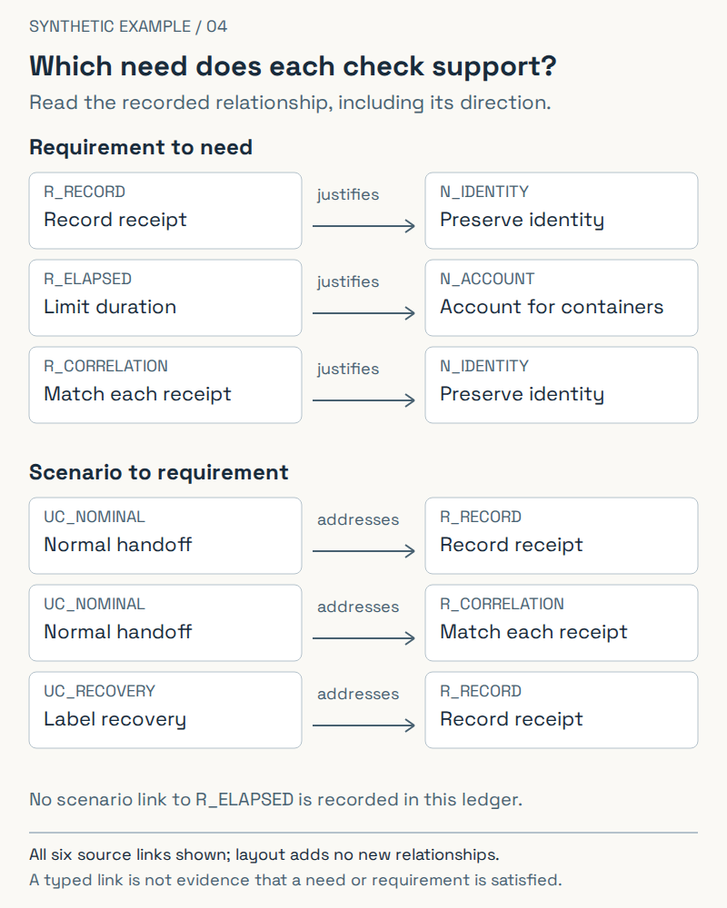](examples/readme-showcase/README.md#need-traces)

Typed links preserve their recorded direction; a link is not a satisfaction proof. [Source, SVG, and text alternative](examples/readme-showcase/README.md#need-traces).

#### Receipt deadlines

[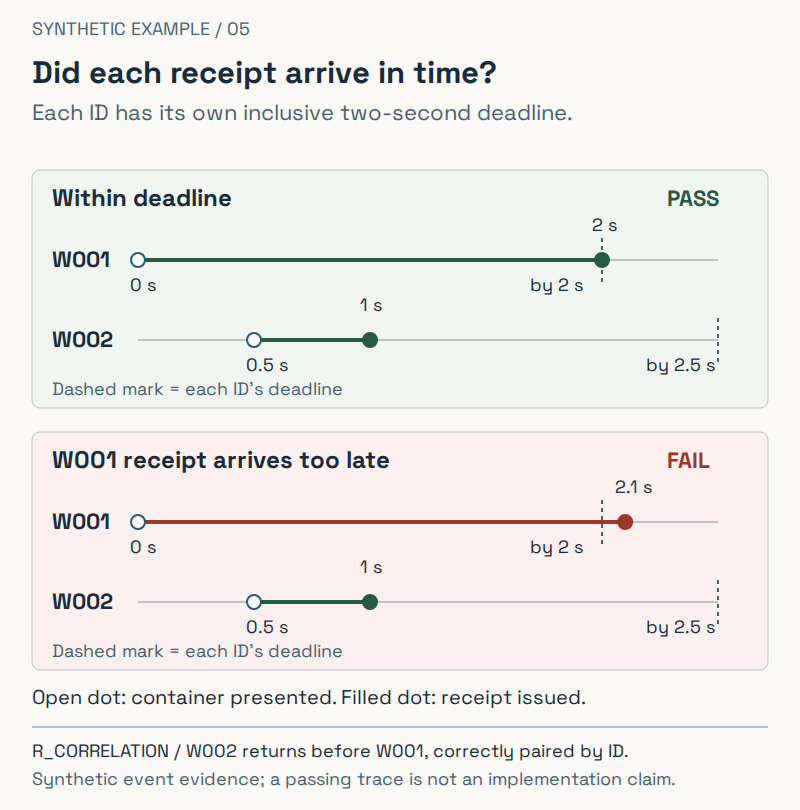](examples/readme-showcase/README.md#receipt-deadlines)

The synthetic trace at two seconds passes the stated deadline; the 2.1-second case fails. [Events, reports, SVG, and text alternative](examples/readme-showcase/README.md#receipt-deadlines).

#### Quantity bounds

[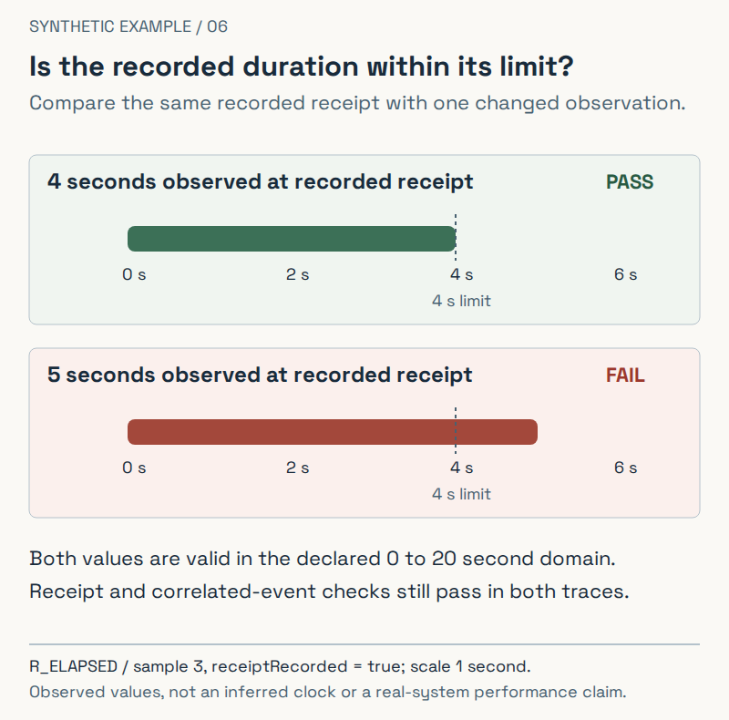](examples/readme-showcase/README.md#quantity-bound)

This is an observed quantity in the synthetic evidence, not an inferred clock. [Observations, report, SVG, and text alternative](examples/readme-showcase/README.md#quantity-bound).

#### A blocked handoff

[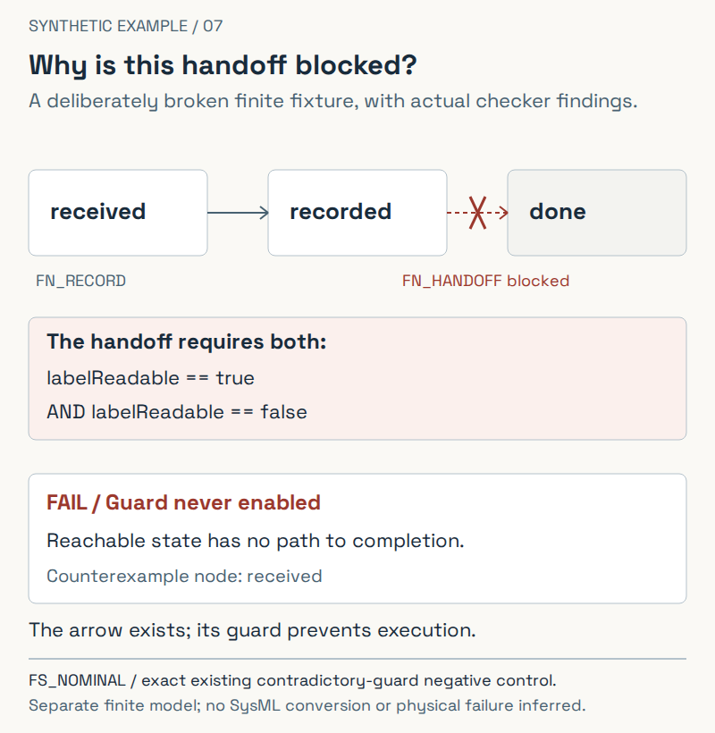](examples/readme-showcase/README.md#blocked-handoff)

A deliberate negative control produces a disabled step and missing completion path. [Fixture, result, SVG, and text alternative](examples/readme-showcase/README.md#blocked-handoff).

#### Alternative approaches

[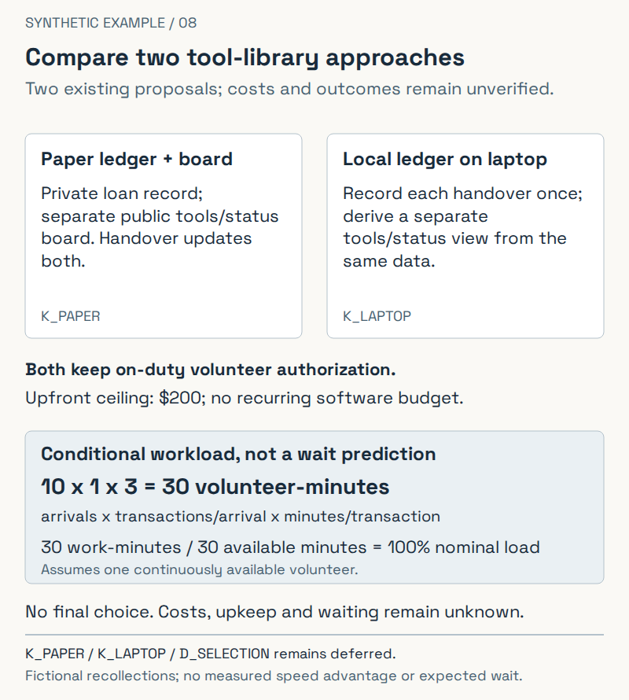](examples/readme-showcase/README.md#tool-library)

The comparison retains open evidence and does not claim a measured speed advantage or final choice. [Concept record, calculation, SVG, and text alternative](examples/readme-showcase/README.md#tool-library).

</details>

The showcase's source and generated-facts checks reproduce the bound SVG content and reports. Its existing PNG rendering receipts are separate evidence about the supplied previews. See the [showcase method and reproduction commands](examples/readme-showcase/README.md#meaning-and-reproduction).

## Reusable engineering components

The [engineering component library](docs/component-library.md) contains **1,076** independently addressable components: 341 original icons, eight mechanical variants, 556 extracted components and assemblies, 103 artwork-only variants, and 68 color swatches. Each has a stable ID, editable SVG, source and treatment records, and an engineering context. The collection includes physical illustrations, schematic elements, connectors, annotations, and document elements.

[Palette PDF](assets/engineering-library/palette.pdf) · [Editable SVG overview](assets/engineering-library/palette.svg) · [Component index](assets/engineering-library/index.json) · [Draw.io library](assets/engineering-library/integrations/drawio/cse-all.xml) · [Kernspan adapter](assets/engineering-library/integrations/kernspan/README.md)

Search a bounded list, inspect an exact ID, and export selected artwork into a new project directory:

```bash
python3 scripts/icons.py list --query pulley
python3 scripts/icons.py show mech-pulley-variant-c
python3 scripts/icons.py export --format drawio --ids mech-pulley-variant-c --out work/presentation
```

The [component agent guide](docs/component-agent-review.md) covers ranked pages, revision-bound selections, and accessible shortlists. Draw.io libraries retain editable labels and metadata, with the SVG embedded as an image; edit its geometry in the SVG master. The Kernspan adapter is an integration component, not a claim that a released application automatically loads the catalog.

Artwork illustrates an explicitly selected model element; choosing an icon does not create an accepted model or define an interface. Inspect the project's actual templates, fonts, and SVGs before applying kit defaults; preserve formal notation and model identities, and compare rendered exports with the selected reference. The library's source and font notices carry their own terms; third-party sources do not endorse CSE.

## Keep the work connected as it grows

- **Retain identities and source versions.** Include all model files needed for the selected context, and keep different roles or same-named entities distinct.
- **Separate current selections from alternatives.** A retained scope can identify the selected root and roles without turning historical declarations or open options into the current design.
- **Carry conditions and evidence forward.** Preserve applicability, units, exclusions, the direction of qualitative goals, and whether linked evidence is planned, supplied, or observed.
- **Review the delivered artifact.** Check actual claims and omissions against source meaning, then rerun the checks affected by a change. A successful local test does not replace an evidence plan or acceptance decision.
- **Keep private work private.** Work in the project, retain appropriate provenance, and do not put private source documents or credentials in the public repository or installed plugin.

The [meaning-context guide](docs/meaning-context.md) and [synthetic handoff example](examples/meaning-context/README.md) show these distinctions in a concrete case. The handoff is complete on the specified acknowledgement; sending alone does not establish completion, and no deadline is invented for waiting.

## Explore further

- [Technical guide](docs/technical-guide.md) and [first concept/scenario trial](docs/end-user-test.md): setup, model output, and local commands.
- [Concept review](docs/concept-review.md), [human tasks](docs/human-task-review.md), and [ownership](docs/ownership-review.md): retained expectations and documentary correspondence.
- [Engineering analysis](docs/engineering-analysis.md), [coupled calculations](docs/coupled-calculations.md), and [behavior review](docs/behavior-review.md): supported computational questions and their contracts.
- [Source-grounded reference library](docs/reference-library.md) and [gallery method](docs/gallery-method.md): provenance, notation, and example boundaries.
- [Model and verification design](docs/model-and-verification.md), [first-version brief](docs/first-version-brief.md), and [contributing](CONTRIBUTING.md): design rationale, deferred work, and development practice.

Project code is [MIT licensed](LICENSE). The separately downloaded parser, bundled fonts, and attributed third-party material retain their own licenses and notices.
